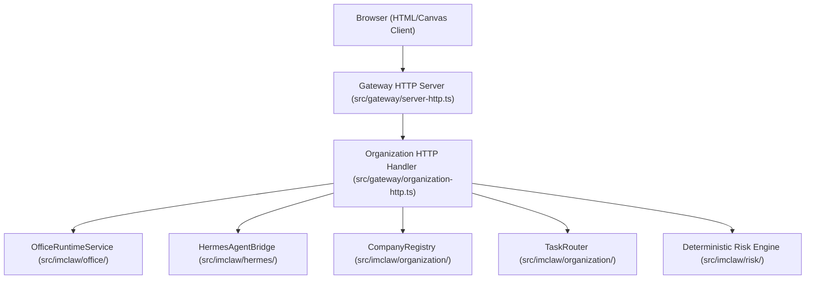

# imClaw Agent Office — Architecture & Runtime Integration

## 1. System Topology

## 2. API Endpoints

- `GET /imclaw/office/3d`: Interactive 2.5D/3D Canvas Office Command Centre
- `GET /imclaw/office`: Operational HTML Dashboard
- `GET /api/agents`: Dynamic agent roster
- `GET /api/imclaw/departments`: Department structures and assignments
- `GET /api/mcp`: Connected tool connectors
- `GET /api/routines`: Background scheduled tasks
- `POST /api/chat`: Desk persona chat
- `POST /api/imclaw/route`: Natural-language task routing
- `POST /api/imclaw/simulate`: Autonomous multi-agent simulation
- `GET /api/hermes/status`: Nous Hermes Agent bridge configuration & learned skills
- `POST /api/hermes/compress`: Multi-turn trajectory compression
- `POST /api/hermes/execute`: Sandboxed execution dispatch
